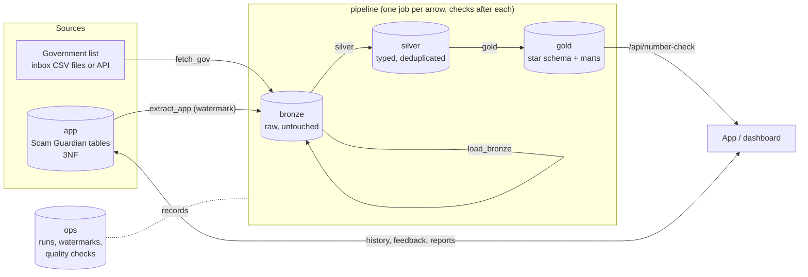

# Yunex backend: MySQL database and data pipeline

This folder holds the real database behind Scam Guardian. It also holds a small pipeline that turns the
app's data and the government scam-number list into plain answers, like *"this number is High risk"*.
We designed it from the YUNEX training session *"Process Development with Data-Driven Decisions"*. The
section [What we took from the presentation](#what-we-took-from-the-presentation) maps each idea from the
slides to what we built.

## Start it in 3 commands

```bash
cd Backend
cp .env.example .env            # then fill in the passwords (and GEMINI_API_KEY if you have one)
docker compose up -d --build    # MySQL + app + pipeline + Adminer, all at once
```

| What | Where |
|---|---|
| Scam Guardian app (the same UI, now saving to MySQL) | http://localhost:8787 |
| Adminer, to look inside the database (log in with a user from `.env`) | http://localhost:8081 |
| MySQL, for your own SQL client | `localhost:3306` |

The pipeline runs once when the stack starts. To run it again after people have used the app:

```bash
docker compose run --rm pipeline              # all steps
docker compose run --rm pipeline silver gold  # only some steps
```

For demo data, copy the synthetic government-list sample into the inbox first:
`cp pipeline/sample/gov_scam_numbers.sample.csv inbox/`

## How the data flows



Each layer is its own MySQL database, so names read the same way as on the slides: `bronze.landed_file`,
`silver.scam_check`, `gold.fact_scam_check`.

| Database | What it holds | Who writes it |
|---|---|---|
| `app` | The app's own data: checks, feedback, number reports, users, trusted people. Built in 3NF so writes are safe. | the app (`yunex_app` user) |
| `bronze` | Raw data exactly as received. Never edited, only added to. | pipeline |
| `silver` | Typed and deduplicated data with one convention: E.164 phone numbers, UTC times, numbers as numbers. | pipeline |
| `gold` | A star schema and two marts, each shaped for one question. | pipeline |
| `ops` | The pipeline's checkpoints: runs, steps, watermarks and quality-check results. | pipeline |

Each database user can do only what it needs. The app user can't read bronze or silver, and the
pipeline user can't change app data. `db/init/06_users.sh` sets this up.

## The questions, and the tables that answer them

We worked backwards from two questions:

1. **"Is this caller's number a known scam number?"** The answer is one plain label: Low, Medium or High.
2. **"How many scams did we catch, per day and channel, and with which tactics?"**

### Grain and keys

Grain means what one row is. For every table we decided it first.

| Table | Grain: one row per… | Primary key | Other keys |
|---|---|---|---|
| `app.scam_check` | checked message, spoken check or finished call | `check_id` (surrogate) | `public_id` (the id the client sees) |
| `app.scam_check_tactic` | (check, tactic). The **M:N bridge**. | `check_id + tactic` | FKs to `scam_check`, `tactic` |
| `app.check_feedback` | check that has a "was this right?" answer (**1:1**) | `check_id` (PK = FK) | |
| `app.scam_report` | user report of a phone number | `report_id` | `phone_e164`, optional `check_id` |
| `app.app_user` / `app.trusted_contact` | protected person / trusted person (**1:N**) | `user_id` / `contact_id` | FK `trusted_contact.user_id` |
| `bronze.landed_file` | file or API page, as received | `file_id` | `sha256` unique (no double landing) |
| `bronze.gov_scam_number` | data line of a landed file (all text) | `file_id + line_no` | |
| `bronze.app_event` | version of an app row | `event_id` | `source_table + source_id + source_updated_at` unique |
| `silver.gov_scam_number` | phone number on the government list | `phone_e164` | |
| `silver.scam_check` / `silver.user_report` | check / report (latest version) | `check_id` / `report_id` (business keys) | |
| `gold.dim_date` | calendar day | `date_key` (yyyymmdd) | |
| `gold.dim_channel` / `dim_risk_level` / `dim_tactic` | channel / risk level / tactic | `*_key` (surrogate) | `code` (business key) |
| `gold.fact_scam_check` | scam check | `check_key` (surrogate) | `check_id` (business key), FKs to the dimensions |
| `gold.bridge_check_tactic` | (check, tactic) | `check_key + tactic_key` | |
| `gold.mart_daily_scam_summary` | day and channel | `date_key + channel_key` | |
| `gold.mart_number_risk` | phone number on the government list or reported by a user | `phone_e164` | FK `risk_level_key` |

**Number risk rule:** High means the number is on the government list or has 10 or more user reports.
Medium means 3 to 9 user reports, and Low means 1 or 2.

The star in gold has `fact_scam_check` in the middle and `dim_date`, `dim_channel`, `dim_risk_level` and
`dim_tactic` around it. The tactic dimension connects through `bridge_check_tactic`. Dimensions are updated
in place (SCD Type 1). Facts and marts are rebuilt on every run.

## The pipeline and its checkpoints

| # | Step | Input → output | How a re-run stays safe |
|---|---|---|---|
| 1 | `fetch_gov` | inbox files and the government API → `bronze.landed_file` | `sha256` is unique, so the same content lands once |
| 2 | `extract_app` | new and changed app rows → `bronze.app_event` | **watermark** plus `INSERT IGNORE` on a unique key |
| 3 | `load_bronze` | landed files → `bronze.gov_scam_number` | full reload (delete, then insert) |
| 4 | `silver` (`sql/silver.sql`) | bronze → silver | full rebuild; latest version wins |
| 5 | `gold` (`sql/gold.sql`) | silver → gold | dimensions upserted; facts and marts rebuilt |

**Checkpoint 1: quality gates between every layer** (`pipeline/checks.js`, results in `ops.dq_check`):

| Layer | Checks |
|---|---|
| raw | every landed file has a size above 0; every app row up to the watermark was copied |
| bronze | the row count matches the raw file (`expected_rows` was counted on arrival) |
| silver | every phone, date and count parses; no null or duplicate keys; values in range; no row lost since bronze |
| gold | facts, daily totals, tactic links and number-risk totals reconcile with silver |

Each step and its checks run in **one transaction**. If a statement or a check fails, the step rolls back,
the layer keeps its last good data, the run stops, and the log prints the exact command to re-run from that
step. Bad data is caught where it enters a layer, not on the dashboard.

**Checkpoint 2: watermarks** (`ops.watermark`). For each app table we store the highest `updated_at`
already copied. The next run reads only newer rows, with a 1-minute overlap that the unique key makes
harmless, and then moves the mark forward in the same transaction. The app tables load incrementally. Other
loads are full reloads, as the slides recommend ("start with a full reload").

**Checkpoint 3: a record of every run** (`ops.pipeline_run`, `ops.step_run`) holds status, rows written,
retries and the error. Steps that hit a lost connection or a deadlock get a second and third try.

**Scheduling:** `PIPELINE_EVERY_MINUTES` in `.env`. It is `0` by default, which means run once and stop.
Set `1440` to run daily.

## What the app gained

`server.js` uses MySQL when `DB_HOST` is set, which `docker-compose.yml` does. Without it, nothing changes:
`node server.js` still uses `data/store.json`. The interface didn't change.

- History, feedback and call alerts are saved in `app.*`.
- **The client pulls only what it needs.** `/api/history` selects only the columns the History screen
  shows, and the counts in `/api/stats` are computed by MySQL. The message text never leaves the `app`
  database, because the pipeline copies only the fields analytics needs.
- New `GET /api/number-check?number=0124047731` returns
  `{ number, known, risk: "High", govListed, category, reports, advice }` from `gold.mart_number_risk`.
- New `POST /api/reports {number, reason?, checkId?}` lets a user report a number. Reports grow our own
  scam list next to the government one.

## Government list: data contract

The producer promises this format, and the pipeline relies on it. If it changes, tell the team.

- **CSV** (drop into `inbox/`): a header row with `phone_number`, which is required. Optional columns
  are `category` (for example `fake_bank`), `first_reported_at` (`YYYY-MM-DD`) and `report_count`
  (an integer, 1 if empty). Extra columns are ignored.
- **API** (`GOV_SCAM_API_URL`, token in `GOV_SCAM_API_TOKEN`): JSON pages of the form
  `{"items": [ {same fields} ], "next": "<url or null>"}`. The fetcher follows `next`, waits for
  `Retry-After` on 429, retries network errors and 5xx after 1s, 2s and 4s, then gives up loudly. It stops
  at once on 401, 403 or 404.
- Phone numbers may be written in any common form (`+994 12 404 77 31`, `012 404 77 31`, `00994…`).
  Silver turns them into E.164 (`+994124047731`). JS and SQL use the same rules: `app/phone.js` and
  `silver.v_gov_scam_number_typed`.
- A file without `phone_number`, or with a value that won't parse, **stops the run**. Fix the file and drop
  it again, or skip the broken one:
  `UPDATE bronze.landed_file SET skip = TRUE WHERE file_id = …;`

## Team rules we followed

- [x] Docker Compose runs every service at once. No Kubernetes.
- [x] Every key and password lives only in `Backend/.env`. That file is git-ignored, and only
  `.env.example` is committed. Compose refuses to start if a password is missing.
- [x] The client pulls only the data it needs (see above). Each container also gets only the variables
  it needs. The app never sees the root or pipeline passwords.
- [x] The database is MySQL 8.4.
- [x] It is a real database system: schema, users and grants, foreign keys, transactions and a pipeline.
- [x] Existing synthetic data is untouched. `eval/dataset.json`, `scenarios.js`, `audio/` and the demo
  contacts in `index.html` were not changed. The optional sample file only *reuses* demo numbers. It is
  named `*.sample.csv` and is loaded only if you copy it into the inbox. `eval/dataset.json` is not loaded,
  because those rows would show up in the app's real History screen.

## What we took from the presentation

| Slide | What we built |
|---|---|
| **1 · Think in flows** (source → raw → clean → serve) | `app` and the government list → `bronze` → `silver` → `gold`. Raw stays untouched and every later layer can be rebuilt from it. |
| **2 · Idempotency and re-runs** (overwrite the slice, upsert, full vs incremental, watermark) | Full rebuilds inside one transaction, `ON DUPLICATE KEY UPDATE` (MySQL's upsert) for dimensions, `INSERT IGNORE` on unique keys, and a watermark in `ops.watermark` for incremental app loads. |
| **3 · Storage and formats** (land raw as it came) | Files and API pages are stored byte for byte in `bronze.landed_file`, with sha256 and size. |
| **4 · Six habits for APIs** (paginate, token in .env, rate limits, retry with backoff, expect drift, land raw first) | All six are in `steps/fetch_gov.js` and `steps/load_bronze.js`. A missing column fails with a clear message. |
| **5 · SQL and modelling** (business question, grain, facts, dimensions, keys, surrogate vs business keys) | The two questions, the grain table above, a star schema in `gold`, and both surrogate and business keys. |
| **5 · 1:1, 1:N, M:N** | `check_feedback` (1:1), `app_user` → `trusted_contact` (1:N), `scam_check_tactic` and `bridge_check_tactic` (M:N bridges). |
| **5 · 3NF** ("built for writing safely") | The `app` tables: one value per cell (`reason_az/ru/en`, tactics as rows) and nothing that depends on a non-key column. |
| **5 · SCD** ("start with Type 1") | Dimensions and `mart_number_risk` are overwritten in place. Type 2 can come later if a question needs history. |
| **6 · Orchestration** (on time, in order, retries, a record) | `pipeline/run.js`: fixed order, re-run any step, retries on transient errors, history in `ops`, and an optional schedule. |
| **6 · No Kubernetes at a hackathon** | Docker Compose only. |
| **7 · Docker** (images, containers, volumes, network by service name) | `docker-compose.yml` with volumes `mysql_data` and `app_data`. Services reach `mysql:3306`. MySQL and Adminer are opened only to your laptop; the app also to your Wi-Fi, for the phone demo. |
| **8 · Data quality: check every layer** | The raw, bronze, silver and gold gates above. Bad rows fail the task and stop the pipeline. |
| **9 · Team practices** (secrets in .env, data contract, README + diagram, grain and keys in the README) | `.env.example`, the data contract above, and this README with the diagram and the grain table. |
| **Leyla's story** (official data → cleaned → one plain-language answer, `dim_risk_level` Low / Medium / High) | The government list → silver → `mart_number_risk` → `/api/number-check` answers Low, Medium or High with advice. |

### What we left out on purpose

- **Airflow:** heavy for a weekend. `run.js` gives us the same things we need: order, retries, re-running
  a step, a record of runs and a schedule. The slides also say to add it only when it helps.
- **MinIO / Parquet:** our raw data is small, so it lives in MySQL (`LONGTEXT`/`JSON`) and we run one
  service fewer.
- **Kubernetes, snowflake schemas, Data Vault:** the slides call these unnecessary or overkill for a
  hackathon.
- **SCD Type 2:** none of our questions needs history yet.

## Everyday commands

```bash
docker compose ps                    # what is running
docker compose logs -f app           # follow one service
docker compose run --rm pipeline     # run the pipeline again
docker compose down                  # stop everything, keep the data
docker compose down -v               # stop and DELETE all data (also re-runs db/init on the next start)
```

The scripts in `db/init/` run only on the first start, when the volume is empty. After changing them,
run `docker compose down -v` (this deletes the data) or apply the change by hand.

## Files

```
Backend/
├── docker-compose.yml        all services
├── .env.example              copy to .env; the only place for keys and passwords
├── db/init/                  schema: 01_app, 02_bronze, 03_silver, 04_gold, 05_ops, 06_users.sh
├── app/                      store-mysql.js (the app's MySQL store), phone.js, Dockerfile
├── pipeline/                 run.js, checks.js, steps/*.js, sql/silver.sql, sql/gold.sql, sample/
└── inbox/                    drop government CSV/JSON files here (git-ignored)
```
